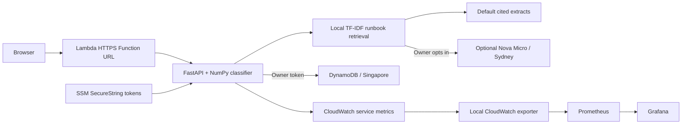

# TicketPilot Apartments

A formal concern tracker for an eight-unit family-managed apartment building, replacing reports that get buried in a Messenger group chat. Tenants use a mobile web form in English or Filipino/Taglish and save a private tracking link. Building managers review one queue, assign action, post updates, and resolve concerns.

## CI/CD

[](https://github.com/rishchaw/ticketpilot-apartments/actions/workflows/ci.yml)

GitHub Actions runs the full test suite, mobile tenant/manager browser checks, Docker and monitoring validation, Lambda emulation and Terraform validation. Manual container releases rerun checks, test the exact images and publish digest-addressed app/Lambda containers to GHCR. A separate manual AWS promotion workflow uses short-lived OIDC credentials and existing remote Terraform state; it stays disabled until account activation and bootstrap are complete. See [CI/CD setup and costs](docs/CI_CD.md).

Publish this standalone folder as the repository root. Local .env/secrets, tenant databases, tools and Terraform state/plans are excluded. GitHub source/CI delivery does not host the Python application through Pages.

## Apartment portal

- **Tenant form:** http://localhost:8080/tenant (also the homepage).
- **Manager dashboard:** http://localhost:8080/manager. Use the existing `ADMIN_TOKEN` from your local `.env` as the manager access code; never give it to tenants.
- Concern categories: water/plumbing, maintenance, electrical, rent/utility billing, contract renewal, and other concerns.
- Each report receives a reference and a private tracking link. Anyone holding that link can read and reply to that report. Unit selection does not verify identity and never grants access to other reports.
- Managers can acknowledge, schedule, assign, update, resolve and reopen concerns; tenants can reply and reopen resolved reports. Private manager notes are excluded from tenant responses.
- Reports from multiple units suggest a possible shared issue for manager review. A manager can publish one confirmed building-wide notice without exposing individual reports.
- The open manager dashboard checks for reports every 30 seconds. Automatic Messenger/SMS/email notifications, verified tenant accounts, photo uploads, payment processing, and automatic contract decisions are not implemented.

The portal currently runs on this PC only. `localhost` links cannot be used from tenants' phones. After a real HTTPS deployment, share the public `/tenant` link or encode that link as a QR code. Keep report-specific tracking links private and out of the group chat.

Set `APARTMENT_NAME` and comma-separated `APARTMENT_UNITS` in `.env` before recreating the Compose app to customize the display name and unit labels. Defaults are **Our Apartment** and units **1-8**. No actual building policies, balances, renewal terms, or maintenance schedules have been invented.

Tenant guidance is reviewed-form-style, category-based text with human updates; it does not use the old IT classifier or call a paid AI provider. The original IT classification/RAG demo is preserved at `/demo`, including optional owner-requested Bedrock generation. Its evaluation scores do not measure apartment-domain or bilingual performance.

Apartment records use an isolated SQLite table locally and a separate query partition in the existing DynamoDB table when deployed. Writes use version checks to reject stale updates. Existing demo tickets are preserved. See [the apartment brief](docs/APARTMENT_USE_CASE.md), [local validation](docs/VALIDATION.md), and [deployment status](docs/DEPLOYMENT_STATUS.md).

Grafana includes a separate **TicketPilot Apartment Operations** dashboard for submission/reply/update counters and API performance. Counters reset on process restart and are not queue-size or lifetime metrics. The manager dashboard reads actual stored concerns, limited to the newest 200 records and at most one DynamoDB query page. Use it for the queue rather than interpreting Prometheus counters as outstanding work.

## Existing cloud architecture and support demo

Support ticket classification, runbook retrieval, owner ticket workflows, and optional Amazon Bedrock RAG. Deploy the FastAPI app and web dashboard to AWS Lambda with a public HTTPS Function URL. Store owner-saved tickets in DynamoDB. Terraform manages the infrastructure; Prometheus and Grafana provide local monitoring and optional AWS CloudWatch dashboards.

This folder is a standalone project. Its source, model artifacts, runbooks, tests, Dockerfiles, and infrastructure do not import files from the original TicketPilot project or `ticketpilot-cloud`.



The default application region is Singapore (`ap-southeast-1`), a practical starting point for visitors in the Philippines. Bedrock is disabled by default. Nova Micro's direct regional endpoint is configured in Sydney (`ap-southeast-2`), because Singapore requires a cross-region inference profile for this model. The optional generation request sends the ticket and retrieved context to that region.

## Run locally

Install Python 3.11 and Docker Desktop. Start Docker Desktop, then run from this folder in PowerShell:

```powershell
py -3.11 -m venv .venv
.\.venv\Scripts\python.exe -m pip install -r requirements-dev.txt
.\.venv\Scripts\python.exe scripts/setup_local.py
docker compose --profile local up --build -d
```

Open the app at http://localhost:8080, Prometheus at http://localhost:9090, and Grafana at http://localhost:3000. Grafana's username is `admin`; its password and the app's owner token are in your generated `.env`. The setup script does not print secrets. For the apartment workflow, open `/manager` with the manager access code. The original synthetic support demo and its seed action remain at `/demo`; those are separate records.

Grafana provisions its Prometheus datasource and the **TicketPilot AWS Operations** dashboard automatically. Local panels show request rate, p95 latency, answer modes, and provider fallback rate. AWS panels remain empty until you enable the AWS monitoring configuration.

Without Docker, use the same Python environment and set `ADMIN_TOKEN`, `METRICS_TOKEN`, and `STORAGE_MODE=sqlite` in your shell before running `python -m uvicorn ticketpilot.api:app --port 8080`. Uvicorn does not load `.env` automatically; use `--env-file .env` if desired.

## Connect AWS and deploy

See [the AWS deployment guide](docs/AWS_DEPLOYMENT.md) for the full sequence and account requirements, and [the MCP guide](docs/AWS_CONNECTION.md) for an optional AWS MCP connection.

With AWS CLI v2 and Terraform on PATH, an authenticated AWS profile, a running Docker engine, and this project's Python environment:

```powershell
$env:AWS_PROFILE = 'ticketpilot'
$env:AWS_REGION = 'ap-southeast-1'
.\.venv\Scripts\python.exe scripts/preflight_aws.py
.\scripts\deploy_aws.ps1
```

The deployment script uploads local owner/metrics tokens as Standard SSM SecureString parameters, applies the ECR bootstrap stack, builds and pushes a Linux/amd64 image, then applies the application stack using its immutable image digest. Each Terraform apply presents a plan and asks for confirmation. No cloud resources are created merely by opening this project or running the tests.

AWS Free plan credits, expiry, and service access are account-dependent. This project does not upgrade your plan, add a payment method, or assume unlimited free usage. Lambda, ECR, DynamoDB, logs, SSM, CloudWatch API calls, and optional Bedrock calls can consume allowances or credits. [AWS Free Tier guidance](https://aws.amazon.com/free/free-tier-faqs/).

## RAG and AI

The packaged PyTorch-trained classifier runs on CPU using NumPy. TF-IDF retrieves up to three relevant articles from 14 bundled runbooks without an external embedding service or vector database.

With `enable_bedrock = true` in `infra/aws/terraform.tfvars`, an authenticated owner can select the AI answer option before saving a ticket. The app sends the retrieved articles to Bedrock Converse and requires citations that refer to retrieved article IDs. Access denial, provider failure, or invalid citations produce extractive fallback guidance and preserve ticket intake. Citation validation checks source IDs; it does not prove every generated claim is supported.

Generation is bounded to 400 output tokens, cached for five minutes (128 entries), and limited to three uncached attempts per minute **per execution environment**. These are cost controls, not global spend limits. The public analysis endpoint never invokes Bedrock or saves records. No Bedrock API key is required: Lambda uses its execution role.

## Monitoring AWS

After authenticating a local AWS profile, set the directory containing its config/cache and run:

```powershell
$env:AWS_PROFILE = 'ticketpilot'
$env:AWS_REGION = 'ap-southeast-1'
$env:AWS_CONFIG_DIRECTORY = Join-Path $env:USERPROFILE '.aws'
docker compose --profile local stop app
docker compose -f compose.yaml -f compose.aws.yaml up --build -d
```

The exporter requires `cloudwatch:GetMetricData` permission. It polls four Lambda metrics every five minutes and exposes them only inside the Compose network. Prometheus stores seven days of data with a 512 MB limit. AWS panels show invocations, errors, throttles, and mean duration for a completed five-minute window. Data is delayed by roughly 5–10 minutes plus CloudWatch ingestion. `GetMetricData` can incur charges; stop the monitoring stack when unused.

New `aws login` profiles may require the credential-process bridge described in [AWS_CONNECTION.md](docs/AWS_CONNECTION.md). Container monitoring supports profiles Boto3 can read inside Linux, such as temporary shared credentials and IAM Identity Center profiles. It cannot execute a Windows `aws.exe` credential process inside a Linux container. The guide includes a host-exporter option for that case.

Prometheus alert rules are included; there is no Alertmanager or notification destination configured. Local API `/metrics` counters reset when a process restarts and do not aggregate Lambda execution environments. Use the CloudWatch exporter for cloud service metrics. Application answer-mode panels cover local Compose requests; they do not represent fleet-wide cloud RAG totals.

## Validate the running local stack

Local validation has passed on November 10, 2026. See [the recorded checks](docs/VALIDATION.md) and [current deployment status](docs/DEPLOYMENT_STATUS.md).

```powershell
.\.venv\Scripts\python.exe scripts/validate_local_stack.py --restart-app
docker buildx build --platform linux/amd64 --provenance=false --load -f Dockerfile.lambda -t ticketpilot-aws-lambda:local .
.\.venv\Scripts\python.exe scripts/validate_lambda_image.py
```

The first command checks the running Compose app and monitoring, verifies ticket persistence after restarting the app, and cleans up its own synthetic ticket. The Lambda check starts and removes an isolated local emulator container. Neither script calls AWS or Bedrock. Lambda uses Python 3.12 / Amazon Linux 2023 so current NumPy wheels work; local development remains compatible with Python 3.11.

## Tests and evidence

```powershell
.\.venv\Scripts\python.exe -m pytest -q
.\.venv\Scripts\python.exe -m ticketpilot.evaluate_pipeline
terraform -chdir=infra/bootstrap init -backend=false
terraform -chdir=infra/bootstrap validate
terraform -chdir=infra/aws init -backend=false
terraform -chdir=infra/aws validate
docker compose --profile local config --quiet
```

Tests exercise real classification/retrieval and HTTP workflows, and emulate AWS DynamoDB/SSM in process using Moto. Bedrock responses are mocked. They do not verify live account permissions or real model output. The 12 authored synthetic evaluation cases yield 9/12 correct categories and 12/12 expected runbooks retrieved in the top three; this is a smoke test, not a real-world accuracy estimate.

The original support demo uses a single owner token. The apartment pilot uses private per-concern tracking capabilities plus a manager token; it does not verify tenant identity. Use fictional records while testing. A global abuse quota, verified tenant onboarding, tracking-link recovery/revocation, and a deliberate data-retention policy need review before a public live-tenant rollout. DynamoDB queue listings use an eventually consistent index; newly saved or updated records may take a moment to appear. Queue and analytics reads are bounded to 100/200 records.

## Stop and clean up

`docker compose down` stops local containers and preserves their data volumes. Cloud cleanup is described in [AWS_DEPLOYMENT.md](docs/AWS_DEPLOYMENT.md#cleanup). The DynamoDB table is protected from deletion by default. Bootstrap teardown deletes all images in the project's ECR repository. Preserve Terraform state files locally; do not publish credentials, `.env`, `.secrets`, state, plans, or personal records.
