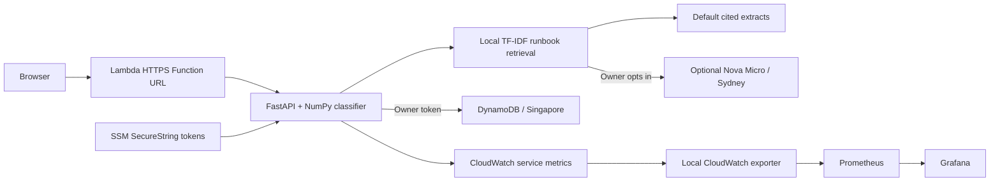

# TicketPilot Apartments

A formal concern tracker for an eight-unit family-managed apartment building, replacing reports that get buried in a Messenger group chat. Tenants use a mobile web form in English or Filipino/Taglish and save a private tracking link. Building managers review one queue, assign action, post updates, and resolve concerns.

## Provider lifecycle and architecture

AWS is live: [tenant portal](https://f76rtnytvzpyuw53oueg5il2by0gbpzc.lambda-url.ap-southeast-1.on.aws/tenant) and [manager dashboard](https://f76rtnytvzpyuw53oueg5il2by0gbpzc.lambda-url.ap-southeast-1.on.aws/manager). AWS is deployed in Singapore and live apartment acceptance passed, including independent DynamoDB reads and guarded synthetic cleanup. Terraform pause returned HTTP 429 and resume restored HTTP 200. GCP remains paused; its login needs renewal before control-plane changes. No plan was upgraded and paid AI stays disabled. The Free plan had USD 100 credits at the pre-deploy check; the regional Lambda quota of 10 requires shared concurrency, without a dedicated per-function cap. Read [current evidence](docs/DEPLOYMENT_STATUS.md).

Use the same provider-first interface for either cloud: `python scripts/cloud.py aws|gcp deploy|pause|resume|status|monitor-start|monitor-stop`. It delegates to native services/scripts/Terraform and guards against enabling both deployments. Default GCP deploy builds and validates its image automatically. Optional monitoring is local and starts explicitly. The USD 10 alert target is not a cap.

See [the stack guide](docs/STACK_GUIDE.md), [portability and rationale](docs/CLOUD_PORTABILITY.md), [AWS architecture](docs/ARCHITECTURE_AWS.md), [GCP architecture](docs/ARCHITECTURE_GCP.md), [operations](docs/PROVIDER_OPERATIONS.md), [AWS guide](docs/aws/README.txt) and [GCP guide](docs/gcp/README.txt). Provider switching does not migrate records or make Terraform/provider identities universal.

## Current operating state

On Windows, double-click STOP_SERVICES.cmd or run `.\.venv\Scripts\python.exe scripts/stop_services.py`. It stops local Compose, removes only the verified owned disposable kind demo, and independently pauses both recorded AWS/GCP deployments. Real data is retained. Use --provider aws or --provider gcp for one cloud, or --local-only to contact neither.

The GCP site is temporarily paused at the user's request, using Terraform-managed manual scaling at zero instances. The public links will return HTTP 503 until resumed. The local Compose application, Prometheus and Grafana are stopped; their volumes and cloud records are preserved.

The Google CLI/ADC session has expired and needs browser renewal before future cloud changes. The already paused site does not need sign-in renewal to stay paused.

Use the existing private Terraform state/settings when running the pause/resume stages in [the GCP guide](docs/GCP_DEPLOYMENT.md). Retained database/image/secret storage can still incur costs. The optional [local Kubernetes portfolio demo](docs/KUBERNETES.md) runs the application, Prometheus and Grafana in kind, with isolated fictional data and no cloud cluster. Its runtime acceptance and cleanup passed in [CI run 44023034882](https://github.com/rishchaw/ticketpilot-apartments/actions/runs/44023034882).

## CI/CD

[](https://github.com/rishchaw/ticketpilot-apartments/actions/workflows/ci.yml)

GitHub Actions runs the full test suite, mobile tenant/manager browser checks, Docker and monitoring validation, Lambda emulation, an isolated GCP/Firestore emulator workflow, a real kind Kubernetes/monitoring workflow and AWS/GCP Terraform validation. Manual container releases rerun checks, test the exact images and publish digest-addressed app/Lambda containers to GHCR. A separate manual AWS promotion workflow uses short-lived OIDC credentials and existing remote Terraform state; it stays disabled until account activation and bootstrap are complete. See [CI/CD setup and costs](docs/CI_CD.md).

Publish this standalone folder as the repository root. Local .env/secrets, tenant databases, tools and Terraform state/plans are excluded. GitHub source/CI delivery does not host the Python application through Pages.

## Deploy to GCP or AWS

Separate plain-text deployment guides: [AWS README.txt](docs/aws/README.txt) (deployed and verified) and [GCP README.txt](docs/gcp/README.txt) (verified Cloud Run deployment).

TicketPilot was deployed and verified on [Google Cloud Run in Singapore](https://ticketpilot-apartments-xliyw4o22q-as.a.run.app/tenant), deployed through Terraform with Firestore persistence and Secret Manager. It scales to zero, allows at most one configured instance, uses manual manager refresh and makes no paid AI calls. The service is currently paused. A USD 10/month gross-cost alert budget is installed; it is not a spending cap. Live tenant/manager privacy and SDK persistence checks passed with fictional records. Follow the [GCP guide](docs/GCP_DEPLOYMENT.md) and [current deployment status](docs/DEPLOYMENT_STATUS.md).

AWS Lambda/DynamoDB and GCP Cloud Run/Firestore use the same FastAPI apartment workflow through native adapters. AWS is serving; GCP is paused. Local Compose uses SQLite. Switching providers does not migrate tenant records. Prometheus/Grafana stay local, with paid AI disabled.

## Apartment portal

- **Live tenant form:** [https://f76rtnytvzpyuw53oueg5il2by0gbpzc.lambda-url.ap-southeast-1.on.aws/tenant](https://f76rtnytvzpyuw53oueg5il2by0gbpzc.lambda-url.ap-southeast-1.on.aws/tenant). The local form remains http://localhost:8080/tenant (also the local homepage).
- **Manager dashboard:** [https://f76rtnytvzpyuw53oueg5il2by0gbpzc.lambda-url.ap-southeast-1.on.aws/manager](https://f76rtnytvzpyuw53oueg5il2by0gbpzc.lambda-url.ap-southeast-1.on.aws/manager), or http://localhost:8080/manager locally. Use the existing `ADMIN_TOKEN` from your local `.env` as the manager access code; never give it to tenants.
- Concern categories: water/plumbing, maintenance, electrical, rent/utility billing, contract renewal, and other concerns.
- Each report receives a reference and a private tracking link. Anyone holding that link can read and reply to that report. Unit selection does not verify identity and never grants access to other reports.
- Managers can acknowledge, schedule, assign, update, resolve and reopen concerns; tenants can reply and reopen resolved reports. Private manager notes are excluded from tenant responses.
- Reports from multiple units suggest a possible shared issue for manager review. A manager can publish one confirmed building-wide notice without exposing individual reports.
- The local manager dashboard checks every 30 seconds; both cloud profiles use manual refresh to avoid unattended compute and database reads. Automatic Messenger/SMS/email notifications, verified tenant accounts, photo uploads, payment processing, and automatic contract decisions are not implemented.

The active AWS HTTPS `/tenant` link can be shared or encoded as a QR code after building guidance and onboarding are reviewed. The retained GCP link is unavailable while that service is paused. `localhost` links work only on the development PC. Keep report-specific tracking links private and out of the group chat.

Set `APARTMENT_NAME` and comma-separated `APARTMENT_UNITS` in `.env` before recreating the Compose app to customize the display name and unit labels. Defaults are **Our Apartment** and units **1-8**. No actual building policies, balances, renewal terms, or maintenance schedules have been invented.

Tenant guidance is reviewed-form-style, category-based text with human updates; it does not use the old IT classifier or call a paid AI provider. The original IT classification/RAG demo is preserved at `/demo`, including optional owner-requested Bedrock generation. Its evaluation scores do not measure apartment-domain or bilingual performance.

Apartment records use an isolated SQLite table locally, a separate query partition in DynamoDB for AWS, or separate Firestore collections for GCP. Cloud Run never relies on its disposable container filesystem for records. Writes use version checks to reject stale updates. Existing demo tickets are preserved. See [the apartment brief](docs/APARTMENT_USE_CASE.md), [local validation](docs/VALIDATION.md), and [deployment status](docs/DEPLOYMENT_STATUS.md).

Grafana includes a separate **TicketPilot Apartment Operations** dashboard for submission/reply/update counters and API performance. Counters reset on process restart and are not queue-size or lifetime metrics. The manager dashboard reads actual stored concerns, limited to the newest 200 locally and 20 in both cloud profiles; AWS also limits each listing to one DynamoDB query page. Use it for the queue rather than interpreting Prometheus counters as outstanding work.

## Preserved AWS architecture and support demo

Support ticket classification, runbook retrieval, owner ticket workflows, and optional Amazon Bedrock RAG. Deploy the FastAPI app and web dashboard to AWS Lambda with a public HTTPS Function URL. Store owner-saved tickets in DynamoDB. Terraform manages the infrastructure; Prometheus and Grafana provide local monitoring and optional AWS CloudWatch dashboards.

This folder is a standalone project. Its source, model artifacts, runbooks, tests, Dockerfiles, and infrastructure do not import files from the original TicketPilot project or `ticketpilot-cloud`.



The default AWS application region is Singapore (`ap-southeast-1`), a practical starting point for visitors in the Philippines. Bedrock is disabled by default. Nova Micro's direct regional endpoint is configured in Sydney (`ap-southeast-2`), because Singapore requires a cross-region inference profile for this model. The optional generation request sends the ticket and retrieved context to that region.

## Run locally

Install Python 3.11 and Docker Desktop. Start Docker Desktop, then run from this folder in PowerShell:

```powershell
py -3.11 -m venv .venv
.\.venv\Scripts\python.exe -m pip install -r requirements-dev.txt
.\.venv\Scripts\python.exe scripts/setup_local.py
docker compose --profile local up --build -d
```

Open the app at http://localhost:8080, Prometheus at http://localhost:9090, and Grafana at http://localhost:3000. Grafana's username is `admin`; its password and the app's owner token are in your generated `.env`. The setup script does not print secrets. For the apartment workflow, open `/manager` with the manager access code. The original synthetic support demo and its seed action remain at `/demo`; those are separate records.

Grafana provisions its Prometheus datasource and the **TicketPilot AWS Operations** dashboard automatically. Local panels show request rate, p95 latency, answer modes, and provider fallback rate. AWS panels remain empty until you enable the AWS monitoring configuration.

Without Docker, use the same Python environment and set `ADMIN_TOKEN`, `METRICS_TOKEN`, and `STORAGE_MODE=sqlite` in your shell before running `python -m uvicorn ticketpilot.api:app --port 8080`. Uvicorn does not load `.env` automatically; use `--env-file .env` if desired.

## Connect AWS and deploy

Use [the AWS guide](docs/AWS_DEPLOYMENT.md) and [provider operations](docs/PROVIDER_OPERATIONS.md) with an authenticated ticketpilot profile, a running Docker Linux engine and the existing project environment:

```powershell
.\.venv\Scripts\python.exe scripts/preflight_aws.py --profile ticketpilot --region ap-southeast-1
.\.venv\Scripts\python.exe scripts/cloud.py aws deploy --profile ticketpilot
```

The central helper delegates to the native Python deployment, builds/promotes an immutable image digest and runs apartment acceptance. It preserves the saved pause state and checks the other provider before enabling AWS. If the recorded-paused GCP login is expired, read the runbook's narrow operator-attestation rules rather than bypassing the guard. Saved plans are inspected for permitted resources/actions and applied without another interactive approval prompt. The old PowerShell deploy entry is legacy and does not provide this lifecycle guard.

Secrets upload outside Terraform state. No plan upgrade, payment-method change or paid AI activation is automatic; requests, storage, logs and optional API polling can consume allowances or credit. [AWS Free Tier guidance](https://aws.amazon.com/free/free-tier-faqs/).

## RAG and AI

The packaged PyTorch-trained classifier runs on CPU using NumPy. TF-IDF retrieves up to three relevant articles from 14 bundled runbooks without an external embedding service or vector database.

Optional Bedrock generation is preserved, but the central/native deployment helpers intentionally require `LLM_PROVIDER=none` and reject paid-AI settings. Changing a tfvars value and rerunning those helpers is not an activation path. A separately authorized experiment must use an explicitly reviewed manual native Terraform plan with the existing private state/image/settings and `enable_bedrock=true`, after model/region/IAM/cost review. Manage and disable that experiment manually, restoring AI-off state before returning to the guarded lifecycle. When deliberately enabled, an authenticated owner can select the AI answer option for a legacy `/demo` ticket. The app sends the retrieved articles to Bedrock Converse and requires citations that refer to retrieved article IDs. Access denial, provider failure, or invalid citations produce extractive fallback guidance and preserve ticket intake. Citation validation checks source IDs; it does not prove every generated claim is supported.

Generation is bounded to 400 output tokens, cached for five minutes (128 entries), and limited to three uncached attempts per minute **per execution environment**. These are cost controls, not global spend limits. The public analysis endpoint never invokes Bedrock or saves records. No Bedrock API key is required: Lambda uses its execution role.

## Monitoring AWS

Use native Lambda/CloudWatch metrics and logs for fleet health. For optional local Prometheus/Grafana diagnostics of the selected active cloud:

```powershell
.\.venv\Scripts\python.exe scripts/cloud.py aws monitor-start --profile ticketpilot
.\.venv\Scripts\python.exe scripts/cloud.py aws monitor-stop --profile ticketpilot
```

Open Prometheus at http://127.0.0.1:9090 and Grafana at http://127.0.0.1:3000; credentials remain private in `.env`. The authenticated cloud scrape runs every 300 seconds. Rate panels use a 15-minute window and need at least two samples. Scrapes invoke cloud compute, and app counters can reset between Lambda environments; they are diagnostic examples rather than queue totals or authoritative fleet metrics. Monitoring starts only on request and stops on pause. See [the stack guide](docs/STACK_GUIDE.md) for queries and dashboards.

The optional legacy CloudWatch-exporter overlay remains separate and can incur API charges; see [AWS connection details](docs/AWS_CONNECTION.md). Prometheus alert rules have no external Alertmanager/notification receiver configured. Neither path sends tenant messages.

## Validate the running local stack

Local validation has passed on November 10, 2026. See [the recorded checks](docs/VALIDATION.md) and [current deployment status](docs/DEPLOYMENT_STATUS.md).

```powershell
.\.venv\Scripts\python.exe scripts/validate_local_stack.py --restart-app
docker buildx build --platform linux/amd64 --provenance=false --load -f Dockerfile.lambda -t ticketpilot-aws-lambda:local .
.\.venv\Scripts\python.exe scripts/validate_lambda_image.py
```

The first command checks the running Compose app and monitoring, verifies ticket persistence after restarting the app, and cleans up its own synthetic ticket. The Lambda check starts and removes an isolated local emulator container. Neither script calls AWS or Bedrock. Lambda uses Python 3.12 / Amazon Linux 2023 so current NumPy wheels work; local development remains compatible with Python 3.11.

## Tests and evidence

```powershell
.\.venv\Scripts\python.exe -m pytest -q
.\.venv\Scripts\python.exe -m ticketpilot.evaluate_pipeline
terraform -chdir=infra/bootstrap init -backend=false
terraform -chdir=infra/bootstrap validate
terraform -chdir=infra/aws init -backend=false
terraform -chdir=infra/aws validate
docker compose --profile local config --quiet
```

Tests exercise real classification/retrieval and HTTP workflows, and emulate AWS DynamoDB/SSM in process using Moto. Bedrock responses are mocked. They do not verify live account permissions or real model output. The 12 authored synthetic evaluation cases yield 9/12 correct categories and 12/12 expected runbooks retrieved in the top three; this is a smoke test, not a real-world accuracy estimate.

The original support demo uses a single owner token. The apartment pilot uses private per-concern tracking capabilities plus a manager token; it does not verify tenant identity. Use fictional records while testing. A global abuse quota, verified tenant onboarding, tracking-link recovery/revocation, and a deliberate data-retention policy need review before a public live-tenant rollout. DynamoDB queue listings use an eventually consistent index; newly saved or updated records may take a moment to appear. Queue and analytics reads are bounded to 100/200 records.

## Stop and clean up

`docker compose down` stops local containers and preserves their data volumes. Cloud cleanup is described in the [AWS guide](docs/AWS_DEPLOYMENT.md#stop-troubleshoot-and-protect-data) and [GCP guide](docs/GCP_DEPLOYMENT.md#stop-or-remove-the-demonstration). The DynamoDB table is protected from deletion by default. Bootstrap teardown deletes all images in the project's ECR repository. Preserve Terraform state files locally; do not publish credentials, `.env`, `.secrets`, state, plans, or personal records.
