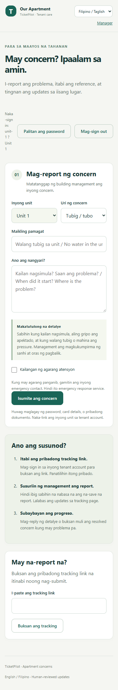
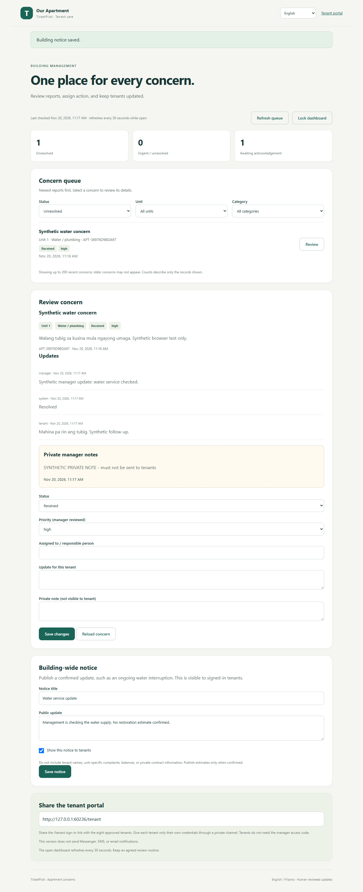

# TicketPilot Apartments

[](https://github.com/rishchaw/ticketpilot-apartments/actions/workflows/ci.yml)

Tenant concern management designed for an eight-unit apartment building. Residents submit water, maintenance, billing and renewal concerns through a mobile-friendly English/Filipino portal. Management receives a structured queue with assignments, status updates, private notes and building-wide notices.

## Application

- Eight approved tenant accounts with persistent sessions and account-bound unit access.
- Private concern tracking, tenant replies and reopening after a resolution.
- Manager-reviewed priority, assignments and tenant-visible updates, with separate internal notes.
- Versioned writes that reject conflicting updates and preserve concurrent changes.

<details>
<summary>View tenant and manager screens</summary>

Screenshots use fictional accounts and concerns from the isolated browser acceptance test.





</details>

## Architecture

A shared FastAPI application implements the workflow and authorization rules. Environment-specific adapters supply persistence and cloud entry points.

| Component | AWS | GCP | Local |
| --- | --- | --- | --- |
| Application runtime | Lambda container and Function URL | Cloud Run and Uvicorn | Docker Compose or kind |
| Persistent records | DynamoDB | Firestore | SQLite |
| Runtime identity | IAM execution role | Attached service account | Local fixture configuration |
| Secrets | SSM Parameter Store | Secret Manager | Ignored environment/secret files |
| Images | ECR | Artifact Registry | Docker image store |
| Infrastructure | Separate Terraform bootstrap/application roots | Separate Terraform bootstrap/application roots | Compose and Kustomize |
| Service telemetry | CloudWatch | Cloud Monitoring and Logging | Prometheus and Grafana |

The cloud paths retain independent datasets and tenant inventories. A shared lifecycle command checks the other deployment before enabling a provider. Deployments promote validated images by immutable digest. [AWS architecture](docs/ARCHITECTURE_AWS.md) · [GCP architecture](docs/ARCHITECTURE_GCP.md) · [Design decisions](docs/CLOUD_PORTABILITY.md)

## Engineering controls

Tenant access combines Argon2id password verification, revocable server-side sessions, CSRF validation, immutable ownership and private tracking keys. Storage adapters preserve expected-version writes through SQLite conditions, DynamoDB condition expressions and Firestore transactions. [Access model](docs/TENANT_ACCESS.md)

GitHub Actions validates the application/browser workflow, Docker/monitoring/Lambda runtime, the GCP container with a real Firestore emulator, local Kubernetes integration and Terraform configuration. Source exports filter credentials, generated state and local notes. [CI and release process](docs/CI_CD.md) · [Validation evidence](docs/VALIDATION.md)

The latest recorded cloud acceptance includes a protected GCP tenant/manager workflow with independent Firestore persistence checks and cleanup of synthetic records. Both cloud deployments are retained in a paused state between sessions. [Deployment status](docs/DEPLOYMENT_STATUS.md)

## Run locally

From a checkout of this repository, create the Python environment and local configuration.

```bash
python -m venv .venv
# Use .venv/Scripts/python.exe on Windows.
.venv/bin/python -m pip install -r requirements-dev.txt
.venv/bin/python scripts/setup_local.py
docker compose --profile local up --build -d
```

Provision the local tenant registry before signing in. The [tenant access guide](docs/TENANT_ACCESS.md) covers unit configuration and local account setup. The application binds to `localhost:8080`, Prometheus to `localhost:9090` and Grafana to `localhost:3000`.

On Windows, `TICKETPILOT.cmd` provides explicit start, stop, status, redeploy and monitoring controls. [Setup and stack guide](docs/STACK_GUIDE.md) · [Operations](docs/OPERATIONS_QUICKSTART.md)

## Technical documentation

| Topic | Reference |
| --- | --- |
| Tenant and manager workflows | [Application behavior](docs/APARTMENT_USE_CASE.md) |
| Component entry points and storage adapters | [Codebase map](docs/CODEBASE_USAGE.md) |
| Provider-specific deployment | [AWS](docs/aws/README.txt) · [GCP](docs/gcp/README.txt) |
| Local Kubernetes and persistence | [kind deployment](docs/KUBERNETES.md) |
| HTTP latency method and measured data | [Benchmarks](docs/CLOUD_BENCHMARKS.md) |

A separate IT support demonstration at `/demo` includes a NumPy-served classifier, TF-IDF runbook retrieval and an optional Bedrock generation adapter. The apartment workflow uses fixed bilingual intake guidance. Hosted paid generation is disabled. [Retrieval implementation and validation scope](docs/RAG_IMPLEMENTATION.md)
