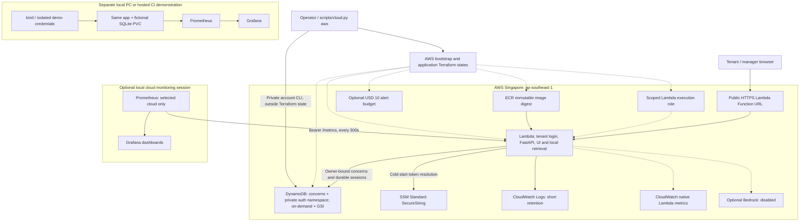

# AWS architecture and rationale

To operate this diagram use **AWS controls** for Lambda and **Dashboards, services and costs** for DynamoDB, ECR, SSM and CloudWatch. See the [beginner redeploy and monitoring guide](OPERATIONS_QUICKSTART.md) and [file-to-service map](CODEBASE_USAGE.md).

Checkpoint November 18, 2026 (Asia/Manila): the tenant-authentication image (digest prefix 722722a0) is deployed to AWS Singapore and intentionally paused with Function URL HTTP429. Eight admitted DynamoDB accounts and individual private handouts are ready. The initial 312 local tests, real browser workflow and Lambda emulator passed; hosted tenant login was not exercised while the requested stop was preserved. GCP retains an older paused revision. See [deployment evidence](DEPLOYMENT_STATUS.md) and [tenant access](TENANT_ACCESS.md).

The native infrastructure remains unchanged. The new paused image and eight-account registry are present; full hosted login acceptance remains distinct from successful local/browser/emulator checks and from historical pre-authentication cloud acceptance. The optional budget is not installed because no alert recipient was supplied; local monitoring is optional.

## Service rationale

Use Lambda because this Python request/response application accepts its tested container packaging and does not need an always-running server. The Function URL supplies the simple HTTPS front door. Tenant account admission, opaque sessions, CSRF, manager authorization and concern ownership stay in application code. The existing DynamoDB table stores private authentication records, salted password hashes and session hashes; no additional hosted identity service is provisioned. Units come from authenticated identities. See [tenant access](TENANT_ACCESS.md). Lambda starts through ticketpilot.lambda_handler/Mangum, while Cloud Run uses a separate Uvicorn wrapper.

Use DynamoDB on-demand for key-based records and bounded index queries. Conditional updates reject stale versions; apartment/legacy records stay logically separate. This avoids fixed table/GSI throughput planning but retains request/storage charges. Provisioned free-capacity allowances do not make on-demand writes free. [Capacity modes](https://docs.aws.amazon.com/amazondynamodb/latest/developerguide/on-demand-capacity-mode.html), [DynamoDB pricing](https://aws.amazon.com/dynamodb/pricing/).

Use Standard SSM SecureString for the two runtime tokens, resolved with the execution role. Values are uploaded outside Terraform state. Standard parameters have no extra parameter-storage fee; KMS/optional higher-throughput conditions are separate. Do not automatically enable advanced parameters or a paid custom key. [Systems Manager pricing](https://aws.amazon.com/systems-manager/pricing/).

Use ECR for the Lambda image and deploy an immutable digest. Registry storage continues while compute is idle. Separate bootstrap/application states keep registry publication and infrastructure changes reviewable. [ECR pricing](https://aws.amazon.com/ecr/pricing/).

## Runtime and cost controls

Keep paid AI disabled and avoid provisioned concurrency. A supported small reserved-concurrency value limits simultaneous work without keeping environments warm. The initial observed regional quota is 10, so this account uses reserved_concurrency=-1 (shared/unreserved) rather than a dedicated small reservation. Record that fallback explicitly. The unreserved fallback is not a one-request or spending ceiling. Any configured DynamoDB request ceilings are best-effort throttling controls, not billing caps.

Terraform pause sets reserved concurrency zero, giving Function URL HTTP429 responses. Resume restores the reviewed enabled setting. Retain the URL, table/index, parameters, image, role and state. Deleting/recreating the Function URL gives a different address. [Function URL deactivation](https://docs.aws.amazon.com/lambda/latest/dg/urls-configuration.html), [reserved concurrency](https://docs.aws.amazon.com/lambda/latest/dg/configuration-concurrency.html).

The optional USD 10 budget sends alerts rather than enforcing a cap. Email alerts need an explicitly supplied recipient; never guess one or claim installation before checking. Check gross spend, credit balance/expiry and actual allowances. No paid-plan upgrade or commitment purchase occurs automatically. [AWS Budgets](https://docs.aws.amazon.com/cost-management/latest/userguide/budgets-managing-costs.html).

## Native monitoring and separate local tooling

Use Lambda/CloudWatch for deployed invocations, errors, throttles, duration and execution logs. Lambda publishes native invocation metrics without an additional metric charge; log ingestion, dashboards and API retrieval may still cost. [Lambda metrics](https://docs.aws.amazon.com/lambda/latest/dg/monitoring-metrics.html).

Prometheus/Grafana are optional local Compose/kind workloads. Central monitor-start selects only the active cloud and scrapes on a 300-second interval; pause stops local cloud monitoring. Scrapes still invoke the cloud endpoint and can consume usage. The existing optional CloudWatch exporter is another local integration with API charges. None is an always-running AWS monitoring server in this architecture.

App counters reset per execution environment and do not form global queue totals. The manager queue reads stored records and remains authoritative for the bounded records shown. One domain application plus native managed services is a modular monolith, not a fabricated collection of TicketPilot microservices.

Deployment evidence must include the exact digest, storage mode, AI-off setting, private tracking/manager-note isolation, version conflicts and independent DynamoDB persistence with fictional records/guarded cleanup. CI and local Lambda emulation do not prove current account permissions. See [operations](PROVIDER_OPERATIONS.md), [AWS guide](aws/README.txt) and [portability](CLOUD_PORTABILITY.md).
