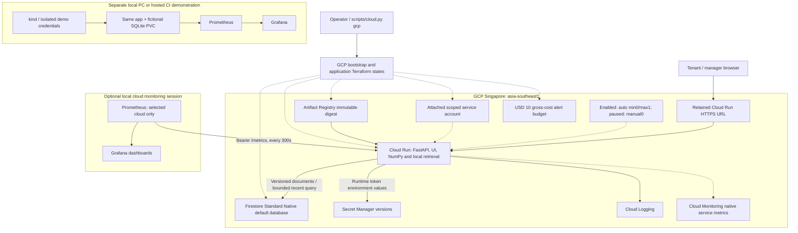

# GCP architecture and rationale

Checkpoint: November 17, 2026, Asia/Manila. This path was deployed/accepted on November 16, then intentionally paused with Terraform manual-zero scaling. Public URLs last returned HTTP503. The latest recorded CLI/ADC session expired; renew credentials before control-plane changes without resuming just to sign in. See [deployment status](DEPLOYMENT_STATUS.md).

The diagram separates cloud platform resources from local Kubernetes. It adds no hosted cluster, paid AI endpoint or cloud Grafana server.

## Service rationale

The central GCP deploy builds Dockerfile.gcp and runs the pinned real Firestore emulator validation before native all, checking that the promoted local image ID matches the validated image. --skip-build --local-image selects an explicitly prebuilt/prevalidated image and skips that local check.

Use Cloud Run for the existing HTTP container: Uvicorn serves the same FastAPI routes without a VM/cluster to maintain. Enabled settings are request-based CPU, 1vCPU/512MiB, concurrency4, timeout30s and automatic min0/max1. Free usage is shared by billing account and applied at Tier1 prices; Singapore pricing can differ. [Cloud Run pricing](https://cloud.google.com/run/pricing).

Use Firestore because the Cloud Run writable filesystem is disposable. Separate concern/settings/legacy collections and transactional version checks preserve the application's contract. Only an eligible database receives the daily free quota; inspect existing mode/location instead of replacing it. The managed database has deletion protection, Terraform ABANDON and no configured PITR/backup schedule. [Container contract](https://docs.cloud.google.com/run/docs/container-contract), [Firestore quotas](https://docs.cloud.google.com/firestore/quotas).

Use the attached runtime service account for Firestore and access to only the two named Secret Manager resources. No downloaded account key is needed. Versions are uploaded outside Terraform state; rotate deliberately and roll out a revision to update environment secrets. Secret versions/accesses can consume shared account allowances/credit. [Secret Manager pricing](https://cloud.google.com/secret-manager/pricing).

Use regional Artifact Registry with digest deployment, retention of the deployed tag/newest two images and cleanup of eligible older versions. Paid automatic scanning stays disabled for this demonstration. Storage remains while compute is paused. [Artifact Registry pricing](https://cloud.google.com/artifact-registry/pricing).

## Pause and spending boundaries

Terraform paused=true selects MANUAL scaling with zero instances; resume selects paused=false and restores automatic min0/max1. Deploy preserves the saved pause state. The address, records, images, secrets, identity and budget remain. Idle automatic scale-down alone still permits another request to start the service.

Manual-zero lets in-flight requests finish and rejects new normal service-URL requests. Traffic-tag-only revisions need separate inspection before claiming every endpoint offline. A scaling-mode change does not require a new image revision. Keep state/generated variables and reconcile console changes. [Manual scaling](https://docs.cloud.google.com/run/docs/configuring/services/manual-scaling).

The installed USD 10 budget tracks gross cost before credits and sends alerts; this configuration is not a spending cap. Check recipients, remaining credit and expiry. Retained storage/versions can still cost while paused. AI stays off, with CPU inference/local retrieval retained; no automatic billing-plan upgrade occurs. [Cloud Billing budgets](https://docs.cloud.google.com/billing/docs/how-to/budgets).

## Monitoring and acceptance

Cloud Monitoring is the native view for service request counts, errors, latency, instances and memory; Cloud Logging holds request/container logs. No Prometheus/Grafana cloud server is needed. [Cloud Run monitoring](https://docs.cloud.google.com/run/docs/monitoring).

Optional local monitor-start selects one active cloud with 300-second scraping; pause stops that monitoring. Requests can still start an enabled instance, so manager refresh remains manual with queue20. Process counters and bounded queues are not lifetime analytics. Compose/kind dashboards remain separate local demonstrations.

Recorded acceptance used fictional concerns for private tracking/cross-key denial, manager-note isolation, replies/reopening, concurrency conflicts and independent exact-ID Firestore reads via ADC. This does not verify tenant identity or migrate other providers' records. See [GCP guide](gcp/README.txt), [operations](PROVIDER_OPERATIONS.md) and [portability](CLOUD_PORTABILITY.md).
