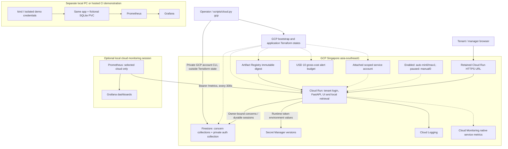

# GCP architecture and rationale

The GCP deployment uses Cloud Run and Firestore in Singapore. Shared application routes and record contracts are packaged for an HTTP server. [Operations](OPERATIONS_QUICKSTART.md) · [Code map](CODEBASE_USAGE.md) · [Latency baseline](CLOUD_BENCHMARKS.md)

The authenticated release and eight-account Firestore registry passed live tenant/manager acceptance on November 19, 2026. Independent exact-ID reads confirmed persistence, and guarded cleanup removed the two synthetic concerns. The service was subsequently paused. Exact revisions, digests and current recorded state are in [deployment status](DEPLOYMENT_STATUS.md).

Account and session persistence uses a dedicated Firestore collection. Native cloud resources and the isolated local Kubernetes validation environment have separate lifecycles.

## Service rationale

The central GCP deploy builds Dockerfile.gcp and runs the pinned real Firestore emulator validation before native all, checking that the promoted local image ID matches the validated image. --skip-build --local-image selects an explicitly prebuilt/prevalidated image and skips that local check.

Use Cloud Run for the existing HTTP container: Uvicorn serves the same FastAPI routes without a VM/cluster to maintain. Enabled settings are request-based CPU, 1vCPU/512MiB, concurrency4, timeout30s and automatic min0/max1. Free usage is shared by billing account and applied at Tier1 prices; Singapore pricing can differ. [Cloud Run pricing](https://cloud.google.com/run/pricing).

Use Firestore because the Cloud Run writable filesystem is disposable. The updated source separates concern/settings/legacy/authentication collections and uses transactional version checks. Its private authentication collection stores the eight admitted identities, salted password hashes, session hashes and revocation versions; a separate GCP inventory must be provisioned before the new portal is enabled. Only an eligible database receives the daily free quota; inspect existing mode/location instead of replacing it. The managed database has deletion protection, Terraform ABANDON and no configured PITR/backup schedule. [Container contract](https://docs.cloud.google.com/run/docs/container-contract), [Firestore quotas](https://docs.cloud.google.com/firestore/quotas).

Use the attached runtime service account for Firestore and access to only the two named Secret Manager resources. No downloaded account key is needed. Versions are uploaded outside Terraform state; rotate deliberately and roll out a revision to update environment secrets. Secret versions/accesses can consume shared account allowances/credit. [Secret Manager pricing](https://cloud.google.com/secret-manager/pricing).

Use regional Artifact Registry with digest deployment, retention of the deployed tag/newest two images and cleanup of eligible older versions. Paid automatic scanning stays disabled for this demonstration. Storage remains while compute is paused. [Artifact Registry pricing](https://cloud.google.com/artifact-registry/pricing).

## Pause and spending boundaries

Terraform `paused=true` selects MANUAL scaling with zero instances. Resume sets `paused=false` and restores automatic min0/max1 scaling. Image deployments preserve the saved pause state. The URL, records, images, secrets, identity and budget are retained. Automatic idle scale-down keeps the service available to new requests.

Manual-zero lets in-flight requests finish and rejects new normal service-URL requests. Traffic-tag-only revisions need separate inspection before claiming every endpoint offline. A scaling-mode change does not require a new image revision. Keep state/generated variables and reconcile console changes. [Manual scaling](https://docs.cloud.google.com/run/docs/configuring/services/manual-scaling).

The installed USD 10 budget tracks gross cost before credits and sends alerts; this configuration is not a spending cap. Check recipients, remaining credit and expiry. Retained storage/versions can still cost while paused. AI stays off, with CPU inference/local retrieval retained; no automatic billing-plan upgrade occurs. [Cloud Billing budgets](https://docs.cloud.google.com/billing/docs/how-to/budgets).

## Monitoring and acceptance

Cloud Monitoring is the native view for service request counts, errors, latency, instances and memory; Cloud Logging holds request/container logs. No Prometheus/Grafana cloud server is needed. [Cloud Run monitoring](https://docs.cloud.google.com/run/docs/monitoring).

Optional local monitor-start selects one active cloud with 300-second scraping; pause stops that monitoring. Requests can still start an enabled instance, so manager refresh remains manual with queue20. Process counters and bounded queues are not lifetime analytics. Compose/kind dashboards remain separate local demonstrations.

Live acceptance covers tenant sign-in, ownership restrictions, CSRF and unit-spoof denial, manager note isolation, replies/reopening and conflicting updates. The validator independently reads only its exact synthetic Firestore documents and removes them with guarded cleanup. [Validation](VALIDATION.md) · [GCP guide](gcp/README.txt) · [Operations](PROVIDER_OPERATIONS.md)