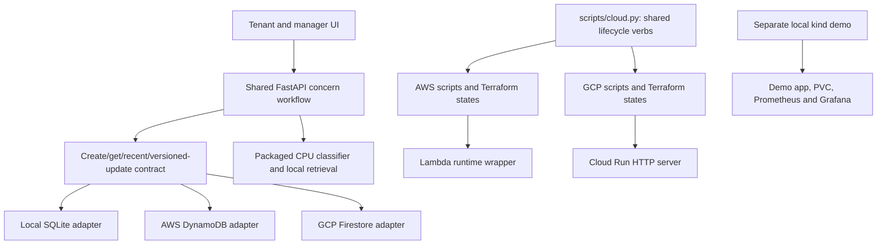

# Cloud portability and deployment choices

The portable application runs on each provider using its own data and credentials. The last recorded states were AWS paused on the tenant-login release and GCP paused on its earlier revision. For a switch to GCP complete **Prepare first tenant-login deployment** before Start. See the [beginner redeploy and monitoring guide](OPERATIONS_QUICKSTART.md) and [deployment evidence](DEPLOYMENT_STATUS.md).

## One application, native cloud adapters

TicketPilot is one modular FastAPI application for eight apartment units. Tenant/manager screens, concern workflow, private tracking, version checks, the NumPy classifier and local TF-IDF retrieval share a release. Modules separate domain behavior, persistence, optional AI and metrics. This keeps deployment and troubleshooting manageable for the building's actual workload.

Managed databases, registries and secret stores are platform services, not separately deployed TicketPilot microservices. Prometheus/Grafana belong to optional local Compose/kind demonstrations; they are not public cloud application tiers.

| Concern | AWS native path | GCP native path | Portable boundary |
| --- | --- | --- | --- |
| HTTPS compute | Lambda container and Function URL | Cloud Run container/service URL | FastAPI routes and domain modules |
| Durable data | DynamoDB on-demand table/recent-record GSI | Firestore Standard Native database | Record shape and conflict behavior |
| Runtime identity | Lambda execution role | Attached service account | SDK default credentials; no embedded keys |
| Runtime secrets | Standard SSM SecureString | Secret Manager versions | ADMIN_TOKEN/METRICS_TOKEN names |
| Images | ECR immutable digest | Artifact Registry immutable digest | Docker build/test process |
| Metrics/logs | CloudWatch | Cloud Monitoring/Cloud Logging | Acceptance criteria and HTTP behavior |
| Infrastructure | infra/bootstrap and infra/aws | infra/gcp/bootstrap and infra/gcp/app | Terraform workflow; separate providers/state |
| Optional local tooling | Compose/kind Prometheus and Grafana | Same local demonstration | Metrics format and dashboards |

Lambda uses its handler/Mangum wrapper; Cloud Run starts Uvicorn. Shared source and Docker tooling do not make those images interchangeable. Terraform resources, IAM, pause semantics and state remain provider-specific. See [AWS architecture](ARCHITECTURE_AWS.md) and [GCP architecture](ARCHITECTURE_GCP.md).

## Operations and data boundaries

The shared CLI exposes provider-first deploy, pause, resume, status, monitor-start and monitor-stop actions. Both providers build by default; GCP also runs its pinned real Firestore emulator check before native deployment, bound to the same local image ID. An explicit --skip-build path uses a previously built/validated image. It delegates real work to separate provider scripts. The default exclusive guard prevents enabling a target when the other configured deployment is active or unknown. A narrow explicit operator attestation is available only with recorded pause and a fresh unavailable HTTP response; it does not turn an auth error into authenticated verification. See [provider operations](PROVIDER_OPERATIONS.md).

Provider switching is not migration or automatic failover. SQLite, DynamoDB and Firestore retain separate datasets; tracking links refer to their original service/data. Moving real records needs an explicit export/import plan, identifier/token preservation and reconciliation. No implicit replication or import is performed.

Preserve both providers' private Terraform states and generated variables while paused. Never apply fresh empty state over existing resources. Cloud pause retains records, images, secrets and alerts. Local kind uses fictional data that is deleted with its owned cluster.

## Cost and engineering rationale

Keep one cloud serving the demonstration at a time. Lambda execution and DynamoDB on-demand avoid idle application instances and fixed throughput planning. Provisioned DynamoDB free capacity is a different allowance, so on-demand requests must not be called free or universally cheaper. [Lambda pricing](https://aws.amazon.com/lambda/pricing/), [DynamoDB pricing](https://aws.amazon.com/dynamodb/pricing/).

Cloud Run is request-based with automatic min0/max1 when enabled and manual0 when paused; Firestore keeps data independently. Singapore serves the intended users, while regional prices/shared billing-account allowances still apply. [Cloud Run pricing](https://cloud.google.com/run/pricing), [Firestore quotas](https://docs.cloud.google.com/firestore/quotas).

USD 10/month is an alert target, not a hard cap. Check the reported AWS USD 100 credit and GCP trial balance/expiry independently. Storage, logs, secret accesses, traffic and optional monitoring requests can consume credit while resources remain. No plan upgrades or capacity commitments are automatic.

Paid AI stays off. CPU inference and local retrieval exercise the ML workflow without a hosted embedding, GPU or vector database. The November 19 Bedrock request reached Nova Micro in Sydney and received a verification-related 403. The IT demo returned its cited fallback. [RAG test result](RAG_IMPLEMENTATION.md)

Local kind demonstrates Deployments, Services, ConfigMaps/Secrets, probes, limits, PVCs and observability without GKE/EKS. Hosted CI acceptance proves the runner's local demonstration, not a hosted cloud cluster or the interrupted PC run. See [Kubernetes](KUBERNETES.md) and [CI/CD](CI_CD.md).
