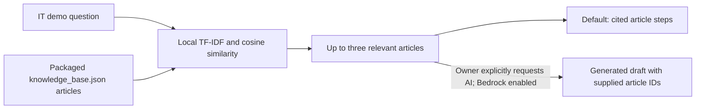

# Retrieval and optional RAG in TicketPilot

The current low-cost configuration uses local retrieval. Optional Bedrock generation is implemented for the original IT support demo, and LLM_PROVIDER=none keeps it disabled. The apartment portal currently uses fixed English/Filipino guidance selected by concern category; it does not generate answers from property documents.

## What the code does

1. [knowledge.py](../ticketpilot/knowledge.py) reads [knowledge_base.json](../data/knowledge_base.json). Each complete article is one retrieval document; there is no PDF-ingestion/chunking pipeline or hosted vector database.
2. A cached TfidfVectorizer uses word unigrams/bigrams, English stopwords and up to 6,000 features. Titles and tags receive extra weight. Search uses cosine similarity, discards scores below 0.08, adds a small matching-category boost and returns the top 3 by default.
3. [assistant.py](../ticketpilot/assistant.py) normally formats the best article's steps and escalation, citing its KB identifier. When no article clears the threshold it asks for human investigation instead of forcing an answer.
4. The owner-only original support workflow may explicitly request generation. If Bedrock is enabled and articles exist, the Converse request includes only their IDs/titles/summaries/steps/escalations plus the question. The prompt treats question/articles as untrusted data, requests answers only from supplied sources and requires KB citations.
5. The code rejects missing citations and IDs outside the retrieved set. This checks reference IDs; it does not prove every generated statement is supported. Provider errors, invalid citations and rate limits fall back to the local article response.

Generation has a 400-token output limit and temperature 0.1. A five-minute, 128-entry process cache avoids repeated identical calls. The default 3 attempts/minute limit is per process/environment, not a global billing cap. Paid generation stays off in both current provider configurations. The public /api/analyze endpoint always uses retrieval only.

## Apartment scope and privacy

Tenant concern submissions do not call the Bedrock path. The apartment GUIDANCE dictionary is generic bilingual intake assistance, not a model trained on the building or a search over leases, bills or notices.

The existing knowledge base belongs to the public IT demo: /api/knowledge and retrieval responses expose its contents. Do not add private leases, bills, passwords or tenant records to that shared JSON file. Apartment-specific RAG would need management-approved FAQs/procedures, a separate authenticated knowledge path, tenant/manager document access rules and evaluation for English/Taglish. Those features are not claimed as implemented.

Docker packages the same local retrieval code for AWS/GCP. DynamoDB, Firestore and SQLite store concerns/authentication; they are not currently vector stores. Changing packaged articles requires a tested image update. See [operations](OPERATIONS_QUICKSTART.md) for Start versus Update, and [tenant access](TENANT_ACCESS.md) for the current account boundary.

Prometheus records answer mode, retrieved-source counts, provider success/fallback attempts and provider latency through ticketpilot/observability.py. These are runtime-process metrics, not a durable billing ledger or proof of answer accuracy. Grafana includes the provider-fallback rate; cloud billing remains separate.
