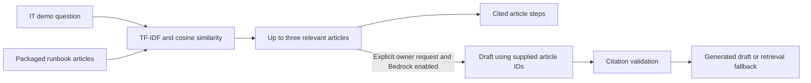

# Retrieval and optional generation

The IT demo at `/demo` uses packaged runbooks for retrieval and cited response steps. An optional owner-requested Bedrock adapter can draft from retrieved context. Hosted configurations select `LLM_PROVIDER=none`, and the public `/api/analyze` endpoint uses retrieval only.

The apartment portal uses hand-authored English/Filipino guidance selected by concern category. Its concern workflow has a separate domain and access boundary.

## What the code does

1. [knowledge.py](../ticketpilot/knowledge.py) loads [knowledge_base.json](../data/knowledge_base.json), treating each complete article as one retrieval document.
2. A cached `TfidfVectorizer` uses word unigrams/bigrams, English stopwords and up to 6,000 features. Titles and tags receive additional weight. Cosine similarity ranks articles, scores below 0.08 are discarded, a matching-category boost is applied and the default result contains up to three articles.
3. [assistant.py](../ticketpilot/assistant.py) formats the best article's steps and escalation guidance with its KB identifier. If relevance is insufficient, the response asks for human investigation.
4. For explicit generation, the Bedrock Converse request includes the question and retrieved article IDs, titles, summaries, steps and escalation guidance. Instructions treat question/article content as untrusted input and require citations to the supplied sources.
5. Citation validation rejects missing IDs and references outside the retrieved set. Provider errors, invalid citations and rate limits return the retrieval fallback. Factual support for each generated statement requires additional answer evaluation.

## Generation controls

The adapter uses a 400-token output limit and temperature 0.1. A five-minute, 128-entry process cache avoids repeated identical calls. The default limit is three uncached provider attempts per minute per process/environment. Application-level limits and caching complement provider billing controls.

The November 19, 2026 live trial reached Nova Micro in Sydney and returned HTTP 403 with account verification pending. The API returned `KB-007` in `retrieval_fallback` mode. Successful live generation remains pending. Mocked tests cover citations, caching, rate limits and provider errors. [Validation evidence](VALIDATION.md)

## Apartment scope and privacy

Tenant submissions follow category-based bilingual intake guidance. Property-document ingestion and authenticated apartment-specific retrieval remain future work. Such a path requires approved FAQs/procedures, document access rules and English/Taglish evaluation.

The IT knowledge base is public through `/api/knowledge` and retrieval responses. Store only public demonstration content in that file. Keep leases, bills, credentials and tenant records in their authorized application data paths.

Docker packages the retrieval assets for both providers. SQLite, DynamoDB and Firestore persist concerns and authentication records. Changes to packaged runbooks require a tested image update. [Codebase map](CODEBASE_USAGE.md) · [Tenant access](TENANT_ACCESS.md)

## Observability

`ticketpilot/observability.py` records answer mode, retrieved-source count, provider attempt outcome and provider latency. Grafana includes a provider-fallback panel. These process metrics reset with the runtime and should be interpreted alongside native cloud telemetry and billing.
